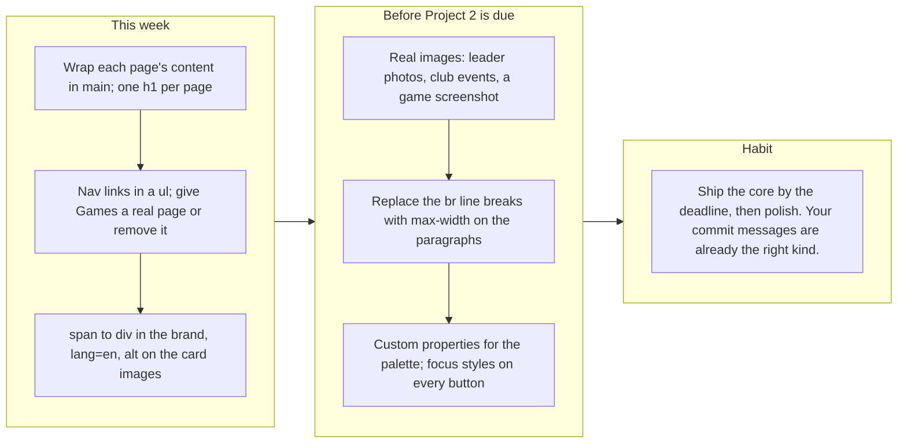

# Project 1: Static Foundations. Feedback for Chris Sanchez

**Student:** Chris Sanchez · **Course:** CSC 436, Fall 2026 · **Reviewed at commit:** [`078dd1c`](https://github.com/Chris-VSanchez/CSC-436_Projects/commit/078dd1c4be43d36caf9260df68dbbe407ee0f996), the last commit that touches `Project 1/`
**Repo:** https://github.com/Chris-VSanchez/CSC-436_Projects/tree/main/Project%201 · **Live:** https://chrisvsanchez.netlify.app/

> **How this review was made.** Your instructor reviewed this project with Claude (Anthropic's AI) as a second set of eyes. Claude cloned the repo, read both pages, the 522-line stylesheet and the script, ran the W3C validator on both pages, loaded the live site in real viewports at 320, 375, 768 and 1280 pixels, opened and closed the contact info on all four leader cards and measured whether any of it was clipped, checked both outbound links, compared the live site to the repo, and read every commit that touches `Project 1/`, including what the folder held on the September 15 deadline. Every note below was read and approved by your instructor. **Your grade is posted in Brightspace, not here.** This file is the reasoning behind it.

## The short version

This is a real website for a real club, and it looks like one. The purple-to-blue hero, the gold marquee, the dark panels and the Sen typeface form one consistent identity across both pages. The leader cards are the best piece of work on the site: they are generated by JavaScript from a data array, and one click listener on the grid handles all four buttons through event delegation, which is a pattern most of the class has not reached yet. Both outbound links work. The marquee stops for visitors who ask for reduced motion. Nothing scrolls sideways at 320, 375, 768 or 1280, because the two grids use `repeat(auto-fit, minmax(min(240px, 100%), 1fr))` and reflow on their own. The README has all four required items, and the commit messages say exactly what each change did.

The gaps are mostly in the HTML. Neither page has a `<main>`. Each page has two `h1`s. The nav links are bare anchors instead of a list, and "Games" goes to `#`. The brand puts a `<p>` inside a `<span>`, which is each page's validator error, and the About page jumps from `h1` to `h3`. The four leader images are injected with no `alt` at all, and the `<html>` tag has no `lang`. There are no real images on the site, only one decorative SVG reused four times. In the CSS, the palette is typed by hand, the About paragraphs use `<br>` for line breaks, which reads raggedly on a phone, and the buttons have no focus style.

One more thing, said plainly. On the September 15 deadline, `Project 1/` held a 71-line page with a header, a hero and the marquee. The leader grid, the footer, the About page, all of the JavaScript and the Netlify deploy arrived between September 21 and October 3. You had an extension, so the timing does not count against you; this review grades the finished site.

## What the numbers looked like

| Check | Result |
|---|---|
| W3C HTML validator | `index.html`: 1 error (`<p>` inside `<span>`), plus notes for missing `lang` and a section without a heading. `about.html`: the same error plus an `h1` to `h3` skip |
| Horizontal scroll at 320 / 375 / 768 / 1280 px | None, on both pages |
| Semantic elements per page | header, nav (bare anchors, no list), 3 section, footer. **No main, no article** |
| `h1` per page | 2 on both pages |
| `aria-current="page"` on the active nav link | Yes, both pages |
| Layout | 8 Flexbox containers, 2 Grids, both `auto-fit` with `minmax(min(240px, 100%), 1fr)` |
| Leader grid at 375 / 1280 | 1 / 4 columns. Event grid on About: 1 / 2 / 3 |
| Media queries | 1, `prefers-reduced-motion`. No layout breakpoints; the layout is intrinsic |
| Custom properties / focus styles | 0 / on nav links only |
| Leader cards | 4, built from a data array; contact toggle verified on all four, open and close, independently |
| Contact info clipping | None. With info open, every card's content ends 6 px inside its 250 px height, at 1280 and at 375 |
| Images | 4 ``, all `background.svg` (3062 by 1500, 341 KB), injected with no `alt` attribute |
| Outbound links | Discord 200, CSI Connect sign-up 200; "Games" is `href="#"` |
| Console errors | 0 |
| Commits touching `Project 1/` | 11, Sep 14 to Oct 3, every message descriptive |
| `Project 1/` at the Sep 15 deadline | `index.html` 71 lines, `style.css` 178 lines, no script, no About page, no footer |
| README | Title, description, how to run, live URL: all four |
| Live vs repo | Identical apart from Netlify's pretty URLs (`/about` for `about.html`) |

---

## Semantic HTML

### What's working

- A `<header>` with a brand link and a `<nav>`, `<section>`s for the hero, the marquee and the leaders, and a `<footer>` on both pages ([index.html#L28-L108](https://github.com/Chris-VSanchez/CSC-436_Projects/blob/078dd1c4be43d36caf9260df68dbbe407ee0f996/Project%201/index.html#L28-L108)). Every page has a real `<title>` ("VGD Club | Home," "VGD Club | About Us"). The active page is marked with `aria-current="page"` and the CSS styles it ([style.css#L67-L70](https://github.com/Chris-VSanchez/CSC-436_Projects/blob/078dd1c4be43d36caf9260df68dbbe407ee0f996/Project%201/style.css#L67-L70)), which is the correct way to show "you are here" and almost nobody in the class did it.

### What to change

- **No `<main>` on either page.** The sections sit directly in `body`. Wrap everything between `</header>` and `<footer>` in `<main>`. It is the landmark screen-reader users jump to, and the brief lists it.
- **Two `h1`s per page.** "Video Game Development Club" and "Our Club Leaders" on the home page ([#L55](https://github.com/Chris-VSanchez/CSC-436_Projects/blob/078dd1c4be43d36caf9260df68dbbe407ee0f996/Project%201/index.html#L55), [#L92](https://github.com/Chris-VSanchez/CSC-436_Projects/blob/078dd1c4be43d36caf9260df68dbbe407ee0f996/Project%201/index.html#L92)); "Our Focus for the Fall 2026 Semester" and "Our Plan for the Fall" on About ([about.html#L79](https://github.com/Chris-VSanchez/CSC-436_Projects/blob/078dd1c4be43d36caf9260df68dbbe407ee0f996/Project%201/about.html#L79), [#L111](https://github.com/Chris-VSanchez/CSC-436_Projects/blob/078dd1c4be43d36caf9260df68dbbe407ee0f996/Project%201/about.html#L111)). Keep one `h1` per page and make the others `h2`. On About, the event cards then become `h3` under an `h2`, which also clears the validator's heading-skip error.
- **The nav is bare anchors, and one goes nowhere** ([index.html#L39-L46](https://github.com/Chris-VSanchez/CSC-436_Projects/blob/078dd1c4be43d36caf9260df68dbbe407ee0f996/Project%201/index.html#L39-L46)). Put the four links in a `<ul>` with `<li>`s so a screen reader announces "list, 4 items." "Games" is `href="#"`: either build the page or drop the link until it exists.
- **The brand's `<p>` inside a `<span>`** ([#L33-L35](https://github.com/Chris-VSanchez/CSC-436_Projects/blob/078dd1c4be43d36caf9260df68dbbe407ee0f996/Project%201/index.html#L33-L35)) is each page's validator error. A `<span>` cannot hold a paragraph. Remove the `<span>`, or make it a `<div>`.
- **The leader images have no `alt`** ([script.js#L47](https://github.com/Chris-VSanchez/CSC-436_Projects/blob/078dd1c4be43d36caf9260df68dbbe407ee0f996/Project%201/script.js#L47)), and the `<html>` tag has no `lang`. The SVG is decorative, so `alt=""` is the right value, but it has to be there. Add `lang="en"` to both pages.
- Small: the leader cards and event cards are `<div>`s. Each is a self-contained item, which is what `<article>` is for.

## CSS layout

### What's working

- **Intrinsic layout done well.** Both grids use `repeat(auto-fit, minmax(min(240px, 100%), 1fr))` ([style.css#L243-L254](https://github.com/Chris-VSanchez/CSC-436_Projects/blob/078dd1c4be43d36caf9260df68dbbe407ee0f996/Project%201/style.css#L243-L254), [#L472-L478](https://github.com/Chris-VSanchez/CSC-436_Projects/blob/078dd1c4be43d36caf9260df68dbbe407ee0f996/Project%201/style.css#L472-L478)). The `min(240px, 100%)` inside the `minmax` is the detail that keeps a single column from overflowing a very narrow phone; most people who use `auto-fit` miss it. Flexbox with `flex-wrap` does the header, the nav and the hero buttons. The marquee is a real keyframe animation with a `prefers-reduced-motion` rule that stops it ([#L515-L522](https://github.com/Chris-VSanchez/CSC-436_Projects/blob/078dd1c4be43d36caf9260df68dbbe407ee0f996/Project%201/style.css#L515-L522)). Hover lifts on the cards, a consistent radius language, and one typeface throughout. The design is the most distinctive in the class.

### What to change

- **No custom properties.** The gold `#d4af37`, the panel greys, the gradient stops and the Discord blue are typed by hand across 522 lines. Put them in `:root` and the next color change is one edit.
- **Line breaks are hard-coded into the copy.** The About paragraphs use `<br>` to break lines where they looked right on your screen ([about.html#L82-L84](https://github.com/Chris-VSanchez/CSC-436_Projects/blob/078dd1c4be43d36caf9260df68dbbe407ee0f996/Project%201/about.html#L82-L84)), and there is an inline `style="margin-bottom: 16px"` on [line 94](https://github.com/Chris-VSanchez/CSC-436_Projects/blob/078dd1c4be43d36caf9260df68dbbe407ee0f996/Project%201/about.html#L94). On a phone those breaks land mid-sentence ("talents outside / of Computer Science"). Delete the `<br>`s, give the paragraphs `max-width: 60ch; margin-inline: auto`, and let the browser wrap. Related: `.mission` sets `align-items` and `gap` but has no `display: flex` or `grid`, so both declarations do nothing ([style.css#L447-L460](https://github.com/Chris-VSanchez/CSC-436_Projects/blob/078dd1c4be43d36caf9260df68dbbe407ee0f996/Project%201/style.css#L447-L460)).
- **Focus styles stop at the nav.** The nav links get `:focus` ([#L67](https://github.com/Chris-VSanchez/CSC-436_Projects/blob/078dd1c4be43d36caf9260df68dbbe407ee0f996/Project%201/style.css#L67)); the hero buttons, the Contact Info buttons and Hide Info do not. Add one `:focus-visible` rule for everything interactive.
- Small: the font is loaded with `@import` inside the stylesheet ([#L2](https://github.com/Chris-VSanchez/CSC-436_Projects/blob/078dd1c4be43d36caf9260df68dbbe407ee0f996/Project%201/style.css#L2)), which delays it until the CSS has downloaded. A `<link>` in the `<head>` starts it sooner.

## Responsive design

### What's working

- No horizontal scroll at 320, 375, 768 or 1280 on either page, measured in real viewports. The leader grid goes from four columns to one, the event grid from three to two to one, and the nav wraps under the brand. All of it without a single breakpoint, which the brief explicitly allows.

### What to change

- **The intrinsic layout covers the grids but not the page.** Nothing else changes between a phone and a desktop: the hero is 80 percent of the screen tall at every width, the nav wraps wherever it happens to run out of room, and the fixed line breaks in the About copy do not adapt at all. One `min-width` query that lays the header out deliberately, and the `max-width` fix above for the paragraphs, would make the phone version look designed rather than reflowed.

## JavaScript interaction

### What's working

- **Data-driven rendering and event delegation** ([script.js#L4-L57](https://github.com/Chris-VSanchez/CSC-436_Projects/blob/078dd1c4be43d36caf9260df68dbbe407ee0f996/Project%201/script.js#L4-L57)). The leaders live in one array of objects, a `for...of` loop builds a card for each, and each button carries a `data-id`. Then one listener on the grid handles every card: `e.target.closest("[data-id]")` finds the button, `find` looks the leader up by id, and `insertAdjacentHTML` adds the contact block with a "Primary Contact" label only when `primaryContact` is true ([#L60-L107](https://github.com/Chris-VSanchez/CSC-436_Projects/blob/078dd1c4be43d36caf9260df68dbbe407ee0f996/Project%201/script.js#L60-L107)). Claude opened and closed all four; each card works independently, and the primary-contact label appears on exactly the two leaders flagged for it. Zero console errors.

  ```mermaid
  flowchart TB
    A["leaderInformation: four objects with id, role, name, email, primaryContact"] --> B["for...of builds one card per leader with a data-id on its button"]
    B --> C["One click listener on the grid, not four: e.target.closest finds the button"]
    C --> D["find by id, then insertAdjacentHTML adds the contact block and a Hide Info button"]
    D --> E["Today: the clicked button gets display none, so keyboard focus drops to the page"]
    E --> F["Next: keep one button, flip its text and aria-expanded, toggle the hidden attribute on the block, and make the email a mailto link"]
  ```

### What to change

- **The toggle loses keyboard users.** Pressing Contact Info hides that button with an inline `display: none` ([#L77](https://github.com/Chris-VSanchez/CSC-436_Projects/blob/078dd1c4be43d36caf9260df68dbbe407ee0f996/Project%201/script.js#L77)), so focus falls back to the page and a keyboard user has to tab from the top to reach Hide Info. Keep one button: flip its text between "Contact Info" and "Hide Info," set `aria-expanded`, and toggle the `hidden` attribute on a contact block that is built once. Fewer lines, and nobody gets lost.
- **The email is plain text.** Wrap it in `<a href="mailto:...">` so a visitor can click it.
- Small: the four email addresses belong to other students. Make sure each officer is happy to have a school address on a public site and in a public repo; a club contact address, or the CSI Connect page, is the usual alternative.

## Repository and deployment

### What's working

- **The README is complete** ([README.md](https://github.com/Chris-VSanchez/CSC-436_Projects/blob/078dd1c4be43d36caf9260df68dbbe407ee0f996/README.md)): title, a real description, step-by-step run instructions, and the live link. One repo with a folder per project is a clean way to hold the semester, and the README says so. The site is on Netlify as the brief asks, it is public, and it matches the repo apart from Netlify's tidy `/about` URLs. Eleven commits touch `Project 1/`, and each message says what changed and why: "Added JS script to automatically generate leader cards. Will add user interactivity next." That is exactly the kind of history the brief describes.

### What to change

- **The timing, for the record.** On September 15 the folder held the header, the hero and the marquee. The leader grid, footer, About page, script and deploy came between September 21 and October 3. You had an extension, so this costs nothing. For Project 2, the habit to build is still shipping a working core early and polishing afterward.

  ```mermaid
  flowchart LR
    subgraph due["At the Sep 15 deadline"]
      direction TB
      d1["Sep 14: folder, header and navbar"] --> d2["Sep 15, 03:38: hero and marquee"]
      d2 --> d3["71-line index.html, 178-line stylesheet. No script, no footer, no About page, no live site."]
    end
    subgraph after["After the deadline"]
      direction TB
      a1["Sep 21 to 22: leader grid, footer, About Us page"] --> a2["Sep 28: CSI Connect link, card and marquee polish"]
      a2 --> a3["Oct 2 to 3: leader cards generated by JavaScript, contact toggle"]
      a3 --> a4["Oct 3: deployed to Netlify, README updated"]
    end
    due --> after
  ```

- Small: there is no `.gitignore` at the repo root. Project 2 has its own, but a root one with `.DS_Store` and `.vscode/` protects every folder. "Dvelopment" in the README is a typo.

## Content and polish

### What's working

- The content is specific and real: the club's mission, why it wants students outside Computer Science, three concrete plans for the fall, the 2026 to 2027 officers, a working Discord invite and a working CSI Connect sign-up. The copy is clear and has a point of view. The footer credits you.

### What to change

- **There are no real images.** The only image is one decorative SVG, 341 KB, reused behind all four leader cards. The brief asks for real images with alt text. Officer photos (with their permission), a photo from a meeting, or a screenshot of a game a member made would change the page more than any other single edit.
- **"UNDER CONSTRUCTION!" and a dead "Games" link** make a finished site read as unfinished. Replace the marquee's first message with something current, and remove "Games" until the page exists.

---

## Your next moves



1. **Fix the outline.** `main`, one `h1`, a list nav, `lang`, `alt`, and the `span`. Twenty minutes, and both pages validate.
2. **Add real images and let the text wrap.** Photos with alt text, and no more `<br>` in paragraphs.
3. **Finish the toggle.** One button with `aria-expanded`, and a mailto link.

*This review lives in a pull request on your repo and only adds files under `Project 1/feedback/`; it does not touch your code. Merge it, close it, or just read it. Your grade is in Brightspace. Questions go to office hours or the Brightspace board. This is a site the club can actually use, Chris; the next step is making the HTML underneath as solid as the design on top.*
